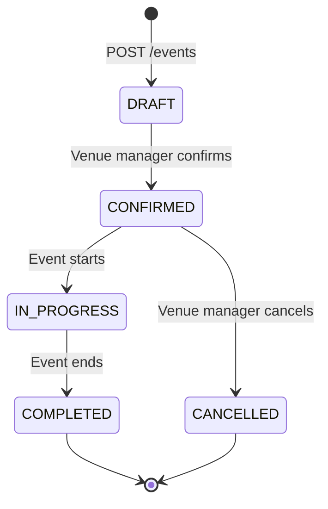
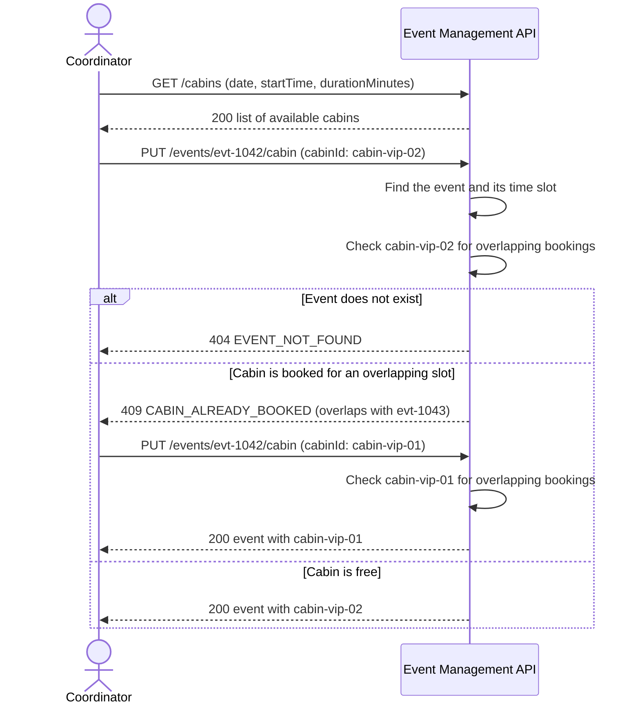
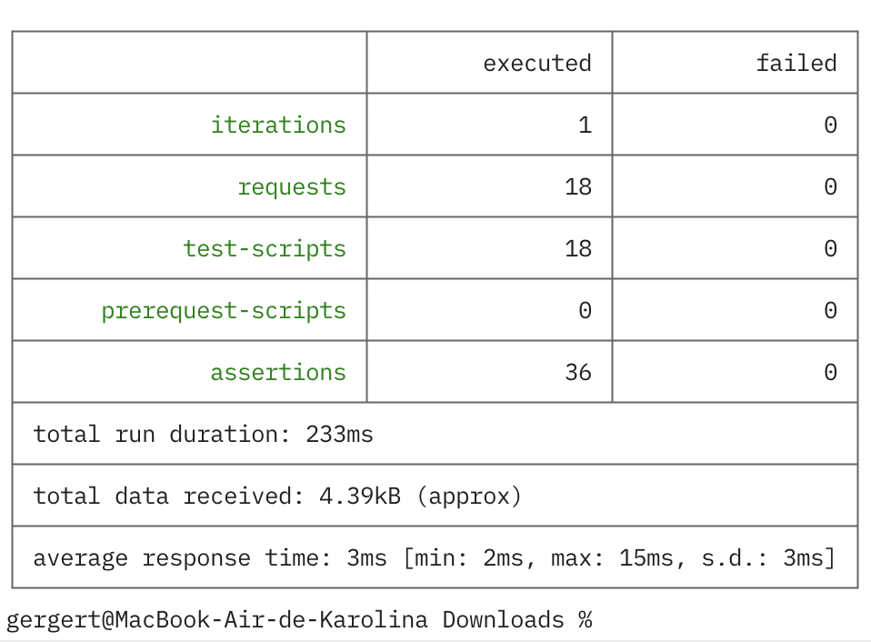

# Event Management API: Ferris Wheel Venue

A business analysis portfolio project. This repository holds an OpenAPI 3.0 specification for a system that coordinates VIP events at a Ferris Wheel venue, together with the requirements traceability matrix, diagrams, a mock server setup, and a Postman collection. You can read the contract in the [interactive API documentation](https://redocly.github.io/redoc/?url=https://raw.githubusercontent.com/lina443/event-management-api/main/event-management-api.yaml), or open the source file, [`event-management-api.yaml`](event-management-api.yaml).

## Problem

A venue manager books a VIP cabin, orders catering and decoration, assigns staff, and schedules the wheel launch. Each step lives in a separate spreadsheet or chat, so double bookings of cabins and staff go unnoticed until the event day. The API contract describes one consistent booking lifecycle and the expected responses when cabin or staff scheduling conflicts are identified.

## Scope

Core entities: **event**, **cabin**, **service** (catering, decoration, photo, video, equipment), **staff assignment**, and **schedule**.

The API covers five areas and 13 operations.

| Area | Operations |
|---|---|
| Events | `GET /events`, `POST /events`, `GET /events/{eventId}`, `PATCH /events/{eventId}`, `PATCH /events/{eventId}/status` |
| Cabins | `GET /cabins`, `PUT /events/{eventId}/cabin` |
| Services | `GET /events/{eventId}/services`, `POST /events/{eventId}/services` |
| Staff | `GET /events/{eventId}/staff`, `POST /events/{eventId}/staff` |
| Schedule | `GET /schedule/{date}`, `GET /schedule/{date}/conflicts` |

## Event lifecycle

An event starts as a draft and moves forward through confirmation, the event day, and completion. A confirmed event can move to cancelled. Any other transition returns `409 INVALID_STATUS_TRANSITION`.



## Cabin assignment with a conflict

A coordinator searches for free cabins and assigns one to an event. The API rejects the first choice because another event holds the cabin, so the coordinator picks a different cabin.



## Business rules in the contract

- The contract specifies validation that the start time is earlier than the end time and that the guest count is positive (`422`).
- The contract defines a conflict response for a cabin assignment that overlaps another booking (`409 CABIN_ALREADY_BOOKED`).
- The contract defines a conflict response for a staff assignment that overlaps another assignment (`409 STAFF_ALREADY_ASSIGNED`).
- The conflict-check response is designed to report cabin overlaps, staff double bookings, and insufficient gaps between activities.

## Error handling

Every error response uses one `Error` schema with a machine-readable `code`, a human-readable `message`, and an optional `details` list with the field and the issue. The specification uses `400` for malformed requests, `404` for unknown resources, `409` for state conflicts, and `422` for validation failures.

## Requirements traceability

The [traceability matrix](traceability.md) links 13 user stories to the 13 operations, their response codes, and acceptance criteria. An excerpt:

| User story | Endpoint | Code | Acceptance criterion |
|---|---|---|---|
| US-02: As a venue manager, I want to create a booking, so that the client's request is on record. | `POST /events` | 201, 422 | The system creates the event with status DRAFT. An end time that is not later than the start time returns 422. |
| US-05: As a venue manager, I want to confirm or cancel an event, so that the team knows which bookings are final. | `PATCH /events/{eventId}/status` | 200, 409 | A COMPLETED event cannot move to CONFIRMED. The system returns 409. |
| US-07: As a coordinator, I want to assign a cabin to an event, so that the client's guests have a reserved space. | `PUT /events/{eventId}/cabin` | 200, 409 | The system rejects the assignment when the cabin has an overlapping booking. |

## Mock server and Postman collection

The repository has no backend. [Prism](https://github.com/stoplightio/prism) reads the specification and answers requests with its examples. The [Postman collection](event-management-api.postman_collection.json) holds 18 requests, one for each operation plus five error cases, and each request checks the status code plus response structure or the documented error code.

```bash
npx @stoplight/prism-cli mock event-management-api.yaml
```

Prism starts on `http://127.0.0.1:4010`. The [mock server guide](mock-server.md) explains how to trigger error responses and run the collection.

## Testing the contract

Newman runs the Postman collection against the Prism mock: 18 requests and 36 test checks (status plus a contract-specific response check). The first run found a contract defect. The examples for `scheduledAt` and `briefingTime` had no timezone offset, so Prism rejected them as invalid `date-time` values with `422`. I added the offset (`+03:00`) to the examples and ran the collection again.

```bash
npx newman run event-management-api.postman_collection.json --env-var "baseUrl=http://127.0.0.1:4010"
```

The screenshot below records the earlier baseline run; after the response-content checks were strengthened, rerun the command above and replace the screenshot with the fresh result.



## Repository structure

```
event-management-api.yaml                    OpenAPI 3.0 specification
traceability.md                              User stories, endpoints, acceptance criteria
diagrams.md                                  Sequence and state diagrams
mock-server.md                               Prism, Postman, and Newman guide
event-management-api.postman_collection.json Postman collection
newman-results.png                           Newman test run
```

## Documentation

- [Interactive documentation (Redoc)](https://redocly.github.io/redoc/?url=https://raw.githubusercontent.com/lina443/event-management-api/main/event-management-api.yaml)
- [OpenAPI source file](event-management-api.yaml)
- [Requirements traceability matrix](traceability.md)
- [Diagrams](diagrams.md)
- [Mock server guide](mock-server.md)
- [Postman collection](event-management-api.postman_collection.json)

## Status and assumptions

This repository contains a specification without a backend. The server URL in the file is a placeholder, and the mock server returns examples from the specification. Request fields, example values, the staff role list, and the status transition matrix are proposed design choices that need validation with business stakeholders. The minimum gap between operational activities is open. The traceability matrix lists five open questions for stakeholders.
