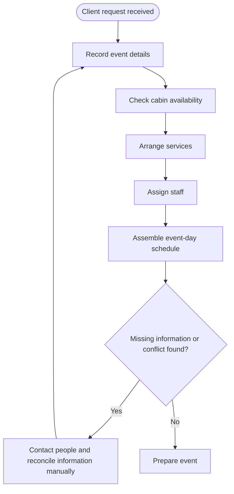
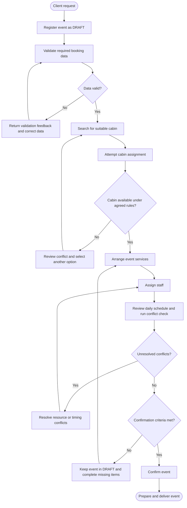
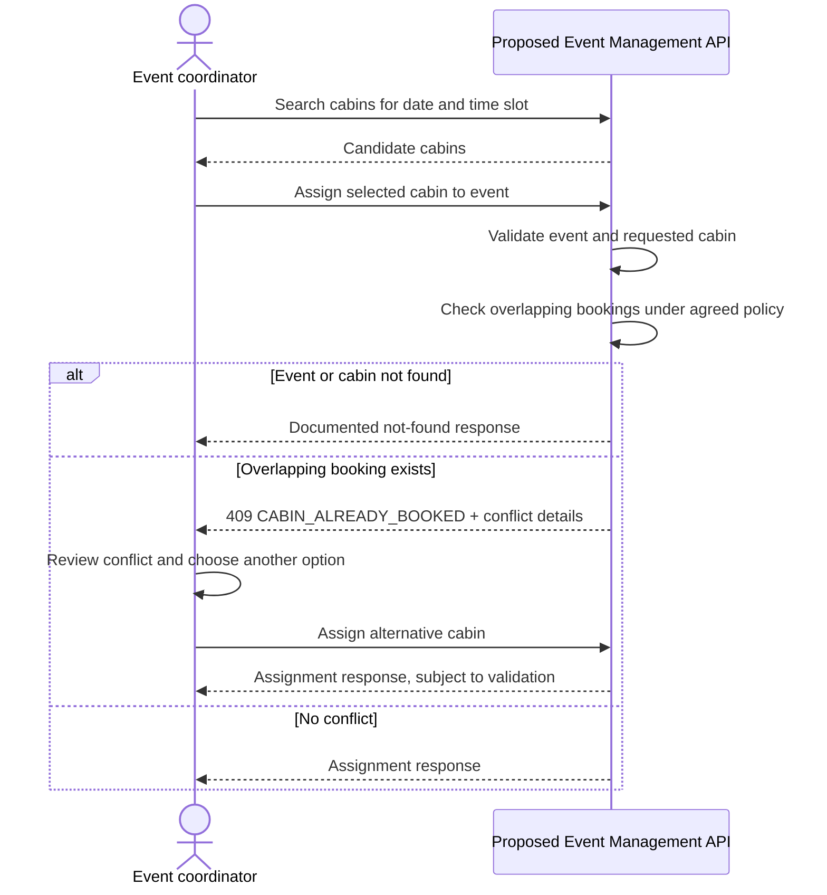
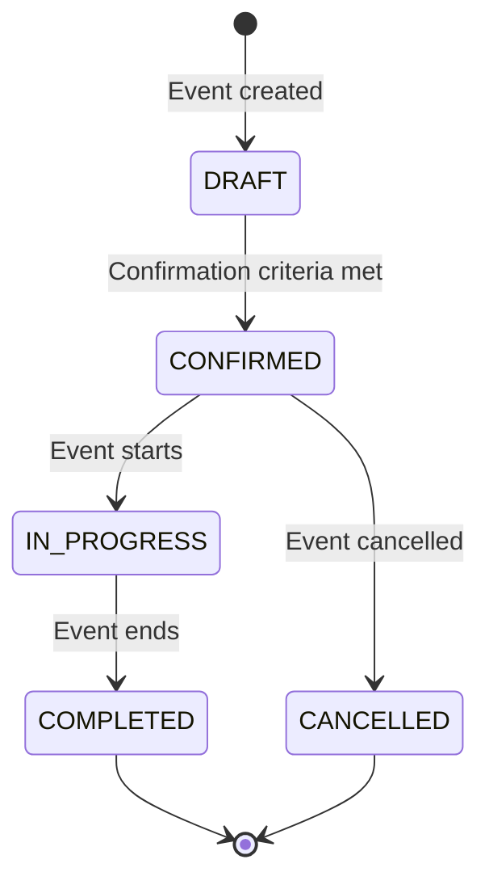

# Business Process and Solution Diagrams

These diagrams support the business analysis case documented in [`business-requirements.md`](business-requirements.md) and [`traceability.md`](traceability.md). The AS-IS diagram is an **illustrative hypothesis**, not a verified model of a real venue. The TO-BE process is a proposal requiring stakeholder validation.

## 1. AS-IS — illustrative current-state hypothesis

The assumed current process may involve manual coordination and reconciliation between event details, cabin availability, services, staff, and schedule information. Validate this model through stakeholder interviews and observation before treating it as an actual AS-IS finding.

**Potential pain points to validate:** repeated data entry, inconsistent event information, late conflict discovery, and unclear criteria for confirming a booking. These are hypotheses, not observed facts.

## 2. TO-BE — proposed target business process

**Decision points requiring business approval:** required data for confirmation, conflict definitions and buffers, treatment of draft/cancelled events, and the rules for correcting assignments.

## 3. Cabin assignment — business decision and exception flow

This sequence describes the intended behavior for US-06 and US-07. It shows both the coordinator's business decision and the proposed API interaction.

The mock contract can illustrate response shapes. Actual conflict enforcement, especially when two coordinators act simultaneously, must be verified in a real implementation.

## 4. Event lifecycle — proposed state model

The status-transition matrix is a proposal, not a confirmed policy. The business owner must decide whether transitions such as `DRAFT → CANCELLED` or `IN_PROGRESS → CANCELLED` are allowed, who can initiate them, and whether a cancellation reason is required. Invalid transitions are proposed to return `409 INVALID_STATUS_TRANSITION` (US-05).

## 5. Requirements mapping

| Diagram | Business question represented | Traceability |
|---|---|---|
| AS-IS hypothesis | Where could manual reconciliation and late conflict discovery occur? | Business requirements §2–3 |
| TO-BE process | What sequence and decisions should the target process support? | BR-01–BR-08; US-01–US-13 |
| Cabin assignment | How should the process respond when a resource is unavailable? | US-06, US-07 |
| Event lifecycle | Which event-state transitions should be allowed? | BR-02, US-05 |

## 6. Validation needed before implementation

- Confirm or replace the AS-IS hypothesis with evidence from interviews, observation, and existing artifacts.
- Validate the TO-BE process with the venue manager, coordinator, and operations lead.
- Agree confirmation criteria, status transitions, conflict taxonomy, and buffer rules.
- Update requirements, diagrams, OpenAPI, and acceptance criteria together when a business decision changes.
