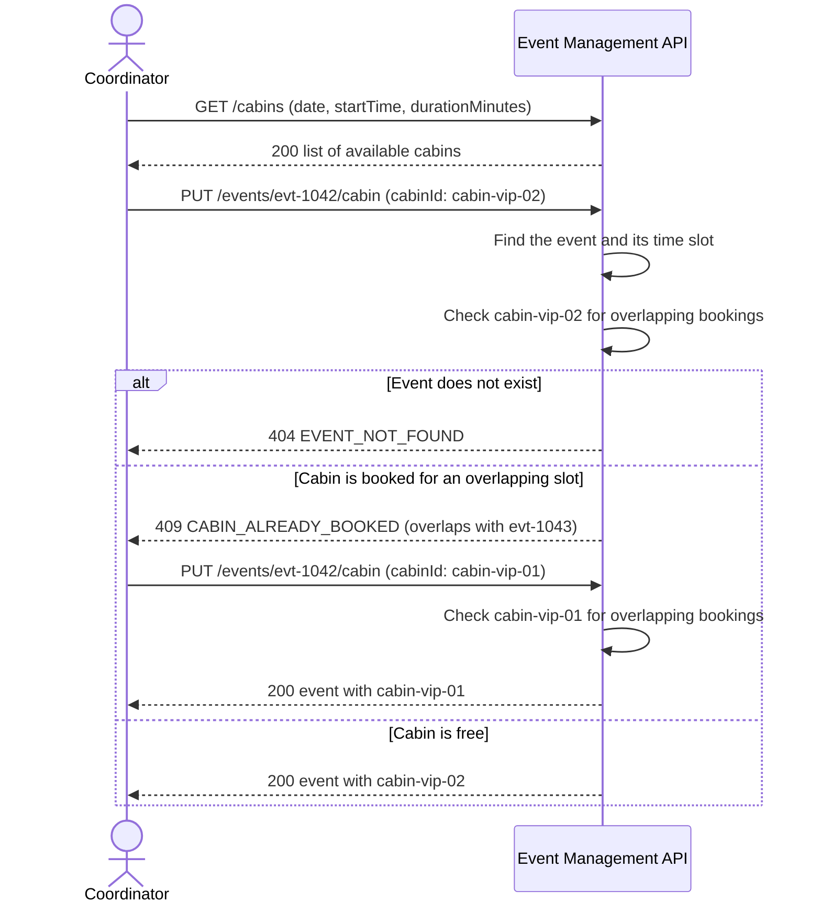
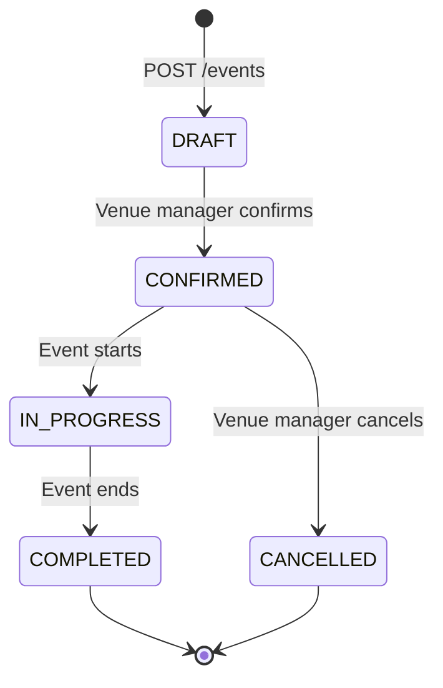

# Diagrams

Two diagrams describe the core behavior of the [Event Management API](event-management-api.yaml). GitHub renders them in the browser.

## 1. Cabin assignment with a conflict

A coordinator searches for free cabins and assigns one to an event. The API rejects the first choice because another event already holds the cabin, so the coordinator picks a different cabin. This flow covers [US-06 and US-07](traceability.md).

## 2. Event lifecycle

An event starts as a draft and moves forward through confirmation, the event day, and completion. A confirmed event can move to cancelled. Any other transition returns `409 INVALID_STATUS_TRANSITION`. The status endpoint is `PATCH /events/{eventId}/status` ([US-05](traceability.md)).

The transition matrix is a proposal. The business owner needs to confirm it, for example whether a DRAFT event can move directly to CANCELLED.
